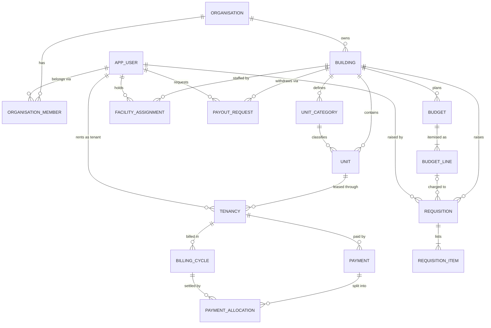

# Portfolio 1 — Database Design and Modelling

## 1. Case study

**Organisation:** Lodgely, a multi-tenant real-estate operations platform. This portfolio models one slice of it: **facility management and rent payments**.

**Nature of the system:** Property-management companies (organisations) use Lodgely to run residential buildings. They register buildings and units, lease units to tenants, bill rent and service charges per cycle, collect payments through a payment gateway (Paystack), withdraw collected funds, and manage maintenance spending against yearly budgets.

**Users of the database:**

| User | What they do |
|---|---|
| Organisation owner / admin | Registers buildings, assigns staff, approves spending |
| Facility manager | Manages units, tenancies, requisitions, payouts for a building |
| Finance staff | Reviews payments, balances and budgets |
| Tenant | Pays rent and service charge, views balance |
| Payment gateway (system) | Confirms payments by reference |

**Major data stored:** organisations, users, buildings, unit categories, units, staff assignments, tenancies (leases), billing cycles, payments, payment allocations, payout requests, budgets, budget lines, requisitions and requisition items.

**Key operations supported:** lease a unit without double-letting it; bill a tenancy per cycle; record a gateway payment exactly once; allocate a payment across cycles (arrears first); compute a tenant's outstanding balance; compute a building's available wallet balance; request a payout; raise a requisition against a budget line and track budget usage.

**Why a relational redesign?** The production system is built on MongoDB (document model, one database per microservice). Portfolios 1–3 re-implement this slice in PostgreSQL to study what a relational model enforces declaratively; Portfolio 4 returns to the document model and compares the two.

## 2. Files

| File | Purpose |
|---|---|
| `01_schema.sql` | Tables, keys, constraints, views, FK indexes |
| `02_sample_data.sql` | Small fictional dataset (no real customer data) |
| `03_constraint_tests.sql` | Attempts to insert invalid data; each attempt should be rejected |
| `er-diagram.mmd` | ER diagram source (Mermaid) |
| `evidence/` | Saved outputs and screenshots |

**Run it (PostgreSQL 16):**

```bash
createdb lodgely
psql -d lodgely -f 01_schema.sql
psql -d lodgely -f 02_sample_data.sql
psql -d lodgely -f 03_constraint_tests.sql > evidence/constraint_tests_output.txt 2>&1
```

## 3. ER diagram

GitHub renders the diagram below; the same source is in `er-diagram.mmd`. A PNG export is in `evidence/`.



Two relationships are many-to-many and are resolved by associative tables: users ↔ organisations (`organisation_member`) and payments ↔ billing cycles (`payment_allocation`, because one payment can settle several cycles and one cycle can be paid in instalments). `requisition_item` is a weak entity, identified by its parent requisition plus a line number.

## 4. Keys and constraints

Every table uses a surrogate `BIGINT` identity primary key (stable, compact, never changes when business data changes). Natural keys are still enforced with `UNIQUE`, so the surrogate key never hides a duplicate.

| Business rule | How it is enforced | Type |
|---|---|---|
| A unit cannot be let to two live tenancies over overlapping dates | `EXCLUDE USING gist (unit_id WITH =, lease_period WITH &&) WHERE status IN ('pending','active')` | Exclusion constraint |
| A tenancy cannot be billed twice for overlapping periods of the same charge | Exclusion constraint on `(tenancy_id, charge_type, period)` | Exclusion constraint |
| At most one active facility manager per building | Partial unique index `WHERE role='facility_manager' AND status='active'` | Partial unique index |
| Emails are unique regardless of case | Unique index on `lower(email)` | Expression index |
| A gateway payment is recorded exactly once | `UNIQUE (payment_reference)` | Unique key (idempotency) |
| A unit's category belongs to the same building | Composite FK `(category_id, building_id)` | Composite FK |
| A payment can only be allocated to cycles of its own tenancy | Composite FKs on `(payment_id, tenancy_id)` and `(cycle_id, tenancy_id)` | Composite FK |
| A requisition can only be charged to its own building's budget | Composite FK `(budget_line_id, building_id)` | Composite FK |
| A succeeded payment has a confirmation time, and only then | `CHECK ((status='succeeded') = (confirmed_at IS NOT NULL))` | CHECK |
| Amounts positive, statuses from a fixed set, leases bounded | Various `CHECK` constraints | CHECK |
| A user who is still a tenant cannot be deleted | FK `tenancy.tenant_user_id` (default `RESTRICT`) | Referential integrity |

`03_constraint_tests.sql` attempts to break each rule; the saved output in `evidence/` shows the database rejecting every invalid row.

**Why an exclusion constraint for tenancies?** The original document model prevents double-letting with a partial unique index that allows only one live tenancy per unit at all. That blocks a legitimate case: signing the next tenant's lease before the current one ends. The range-based exclusion constraint allows back-to-back leases (`[2026-01-01, 2027-01-01)` followed by `[2027-01-01, 2028-01-01)`) and rejects only actual overlaps (tests T1–T3).

## 5. Normalisation

### 5.1 Starting point: an unnormalised rent record

In the document model, a payment record carries its context with it. Flattened, a "rent receipt" looks like this, with a repeating group of cycles it paid for:

```
RentReceipt(payment_ref, payment_amount, payment_status,
            tenant_email, tenant_name, tenant_phone,
            building_name, building_address, unit_label, category_name, bedrooms,
            lease_period, rent_amount,
            { cycle_id, charge_type, period, amount_due, amount_applied }*)
```

This structure has three classic anomalies:

- **Update anomaly:** a tenant's phone number is copied into every receipt, so changing it means updating many rows, and missing one leaves the data inconsistent.
- **Insertion anomaly:** a new, still-vacant unit cannot be recorded, because a unit only exists here as part of a payment.
- **Deletion anomaly:** deleting a tenant's only payment also deletes the only record of their unit's category and bedrooms.

### 5.2 First normal form (1NF)

The repeating cycle group is removed so every attribute is atomic. Each row now holds one (payment, cycle) pair, with candidate key **(payment_ref, cycle_id)**.

### 5.3 Functional dependencies

```
payment_ref               → payment_amount, payment_status, tenancy_id
cycle_id                  → tenancy_id, charge_type, period, amount_due
tenancy_id                → unit_id, tenant_email, lease_period, rent_amount
unit_id                   → building_name, unit_label, category_name
building_name, unit_label → unit_id
building_name, category_name → bedrooms
building_name             → building_address
tenant_email              → tenant_name, tenant_phone
payment_ref, cycle_id     → amount_applied
```

### 5.4 Second normal form (2NF)

Only `amount_applied` depends on the whole key. Payment attributes depend on `payment_ref` alone and cycle attributes on `cycle_id` alone, which are partial dependencies. Splitting them out gives:

- `payment(payment_ref, amount, status, tenancy_id)`
- `billing_cycle(cycle_id, tenancy_id, charge_type, period, amount_due)`
- `payment_allocation(payment_ref, cycle_id, amount)`

### 5.5 Third normal form (3NF)

The relations above still contain **transitive** dependencies, for example `payment_ref → tenancy_id → tenant_email → tenant_phone`. Each determinant becomes its own relation: `tenancy`, `app_user`, `unit`, `unit_category`, `building`. The result is the schema in `01_schema.sql`.

### 5.6 BCNF check

In every final table, each non-trivial determinant is a candidate key. Examples: `(building_id, label)` in `unit` is declared `UNIQUE`, and `(building_id, name)` in `unit_category` is declared `UNIQUE`. The schema is therefore in BCNF, with the deliberate exceptions described next.

### 5.7 Deliberate, controlled redundancy

Four columns technically introduce a transitive dependency:

- `unit.building_id` (also determined by `category_id`)
- `payment_allocation.tenancy_id`
- `budget_line.building_id`
- `requisition.building_id` alongside `budget_line_id`

They exist so a **declarative composite foreign key** can enforce a cross-table rule, such as "a payment may only settle its own tenancy's cycles." Without them, that rule would need a trigger or application code.

This redundancy cannot drift: the composite FK makes it impossible to store a value that contradicts the referenced row. So it trades strict 3NF for a database-enforced integrity rule, while keeping the main benefit of normalisation (no possible inconsistency).

### 5.8 Derived values are computed, not stored

The original system stores running totals (ledger balances, totals withdrawn, budget spent) and updates them in application code on every write. If a write fails halfway or two writes race, these totals can drift from the underlying records.

Here they are **views**:

- `v_cycle_balance`: amount due minus allocations
- `v_building_wallet`: succeeded payments minus payouts
- `v_budget_line_usage`: approved requisition items against each budget line

The trade-off is read cost, since every read recomputes a sum. Portfolio 2 measures that cost at scale and evaluates indexing and materialised views.

## 6. Mapping from the document model

| Document model (MongoDB) | Relational model (this schema) |
|---|---|
| `Building.units[]` embedded array | `unit` table with FK to `building` |
| `Building.unitCategories[]` embedded | `unit_category` table + composite FK from `unit` |
| `Organization.members[]` embedded | `organisation_member` associative table |
| Ledger document with stored running balance | `billing_cycle` + `payment_allocation`, balance derived in a view |
| Archived ledger cycles with stored arrears | Unpaid `billing_cycle` rows (arrears are simply cycles with balance > 0) |
| Wallet with stored `totalWithdrawn` | `v_building_wallet` view |
| Budget items with stored `spentAmount` | `v_budget_line_usage` view |
| Cross-service IDs as plain strings (no enforcement) | Real foreign keys |
| Partial unique index "one live tenancy per unit" | Range exclusion constraint (date-aware) |

## 7. Rules not enforced by the schema alone

Some rules span multiple rows, which declarative constraints cannot express:

- Total allocations of a payment must not exceed the payment amount.
- Total allocations to a cycle must not exceed `amount_due`.
- Only `succeeded` payments may be allocated.
- Approved requisitions must not push a budget line over `expected_amount`.

These rules are exactly where concurrent transactions can break correctness, for example two requisitions passing the budget check at the same time. They are enforced and tested with transactions, locking and isolation levels in **Portfolio 3**.
