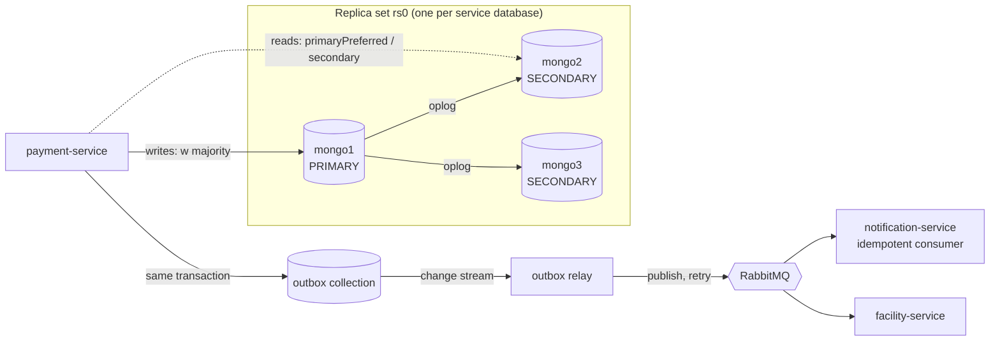

# Portfolio 5 — Distributed and Cloud Database Exercise

Lodgely is already a distributed system: about ten microservices, each owning its own MongoDB database, communicating through a RabbitMQ event exchange. Production uses a managed MongoDB cluster (`mongodb+srv://` connection strings), while local development uses one unreplicated container.

This portfolio builds a **3-member MongoDB replica set** and measures what replication actually guarantees:

- what happens when a node lags or crashes,
- which consistency settings cost what,
- how to keep *services* consistent with each other,
- how the data would be sharded if it outgrew one replica set.

## 1. Files and how to run

| File | Demonstrates |
|---|---|
| `docker-compose.yml` | Three MongoDB 8.0 members (`mongo1`–`mongo3`) and a one-off job that initiates replica set `rs0` |
| `common.py` | Shared connection and logging helpers |
| `01_cluster_status.py` | Topology, votes/priorities, majority size, replication lag, oplog window |
| `02_consistency.py` | Write-concern latency; stale reads, `w:"majority"` vs `w:3` with a lagging secondary |
| `03_failover.py` | Planned step-down and primary crash under live load; data-loss check; node rejoin |
| `04_outbox_change_stream.py` | Fire-and-forget events vs transactional outbox + change-stream relay |
| `05_shard_key_analysis.py` | Shard-key choice by simulation on ~1M Lodgely-shaped payments |
| `evidence/` | Output of every script |

```bash
# 1. Hosts file entry (Linux/macOS: /etc/hosts; Windows: C:\Windows\System32\drivers\etc\hosts)
127.0.0.1 mongo1 mongo2 mongo3

# 2. Start the cluster (stop Portfolio 4's single node first: docker compose down in that folder)
docker compose up -d          # wait ~20 s for the first election
pip install pymongo

# 3. Run everything (~1.5 minutes); 03_failover.py uses `docker kill` / `docker start`
./run_all.sh
```

## 2. Architecture



The primary records every write in its **oplog**; secondaries copy and replay it. If the primary disappears, the remaining members **elect** a new one, which needs votes from a majority (2 of 3).

## 3. Results

The figures below come from the reference run; your own run's figures are in `evidence/`.

### 3.1 Topology (`01_cluster_status.py`)

Three voting members with equal priority. The majority is 2 of 3, so the set survives the loss of any **one** member. The election timeout is 10 s. Lag measured from each member's own applied position was 0.0 s. The oplog window shows how long a member can be offline and still catch up without a full resync.

### 3.2 Consistency with a lagging secondary (`02_consistency.py`)

One secondary was frozen (`fsync` lock) to simulate a slow or partitioned node:

| Step | Observation |
|---|---|
| `w:1` insert | Acknowledged by the primary alone |
| Read the new payment from each member | Primary: found. Healthy secondary: found. **Frozen secondary: NOT FOUND (stale read)** |
| `w:"majority"` insert | Acknowledged in 4.4 ms: primary + healthy secondary = 2 of 3 |
| `w:3` insert (all members) | **Failed after 3.0 s with a write-concern timeout**, yet the document **was on the primary** |
| Unfreeze | The lagging member applied all three writes **73 ms** later (eventual consistency) |

**Lessons:**

- Reading from a secondary trades freshness for load distribution. A tenant who pays and then reads their balance from a lagging secondary could see the old balance.
- `w:"majority"` tolerates one slow node. `w:3` turns any single slow node into a write failure, so it reduces availability.
- **A write-concern timeout is not a rollback.** The write may still be applied, so a client that blindly retries can create a duplicate. This is why idempotency keys (the unique `payment_reference` from Portfolio 1) matter in distributed systems.
- Write-concern latency (C1) was ~5 ms for all three levels, because every member ran on one machine. Across availability zones, each extra acknowledgement adds a network round trip.

### 3.3 Failover under live load (`03_failover.py`)

A writer inserted a payment every 100 ms (`w:"majority"`, retryable writes). A reader polled with `readPreference: primaryPreferred`.

| | F1 planned step-down | F2 primary crash (`docker kill`) |
|---|---|---|
| New primary elected after | **0.13 s** | **10.2 s** (secondaries wait 10 s of missed heartbeats) |
| Longest a write waited | 0.49 s | 10.1 s |
| Writes failed | 0 | 0 |
| Reads failed | 0 | 0 (served by secondaries during the election) |
| Acknowledged writes on the new primary | 55 of 55 | 60 of 60, **no data loss** |
| Crashed node | — | Restarted and rejoined as SECONDARY in ~1.4 s |

**Why nothing was lost:** a `w:"majority"` write is acknowledged only once a second member has it, and an election can only be won by a member holding every majority-committed write. Writes acknowledged with `w:1` can be **rolled back** if the old primary crashes before replicating them. That is the real price of the faster write concern.

**Why nothing failed:** the driver waited for a new primary (server selection) and retried the interrupted write once. To users, a crash looked like a 10-second pause, not an error. Planned maintenance (F1) is almost invisible, which is why rolling upgrades step the primary down first.

### 3.4 Consistency between services (`04_outbox_change_stream.py`)

| | E1 fire-and-forget (original system's pattern) | E2 transactional outbox |
|---|---|---|
| Broker down while 3 payments are confirmed | Payments saved; **all 3 events lost forever** | Events stay `pending` in the outbox; delivered as soon as the broker returns (~0.5 s) |
| Relay crashes after publishing, before marking sent | n/a | On restart the event is re-published; the consumer's unique `eventId` index **ignores the duplicate** |
| Events received / payments | **0 / 3** | **4 / 4** |

The outbox works because the payment update and the event are written in **one transaction in one database**, so both happen or neither does. Delivery to the broker happens afterwards, with retries (at-least-once). Combined with an idempotent consumer, the result is effectively exactly-once.

The relay is woken by a **change stream**, MongoDB's feed of committed changes, which is itself built on the oplog and only available on replica sets. Each relay also sweeps for pending events, so nothing waits for a new insert to be retried.

### 3.5 Sharding: choosing a shard key (`05_shard_key_analysis.py`)

Simulated on ~964,000 payments across 1,782 buildings and 200 organisations. The largest organisation holds 21.8% of the data, mirroring the skew of real property companies. Four shards; ideal share 25%.

| Shard key | Balance (fullest shard) | Insert hotspot | Shards per building query | Largest unsplittable key |
|---|---:|---:|---:|---:|
| `{ _id: 1 }` (monotonic) | 29.6% | **100%** | 4 | — |
| `{ _id: "hashed" }` | 25.1% | 25.1% | **4 (scatter-gather)** | — |
| `{ organisationId: 1 }` | **38.2%** | 38.2% | 1 | **21.8% (jumbo chunk)** |
| `{ buildingId: "hashed" }` | 26.3% | 26.3% | **1** | 0.10% |
| `{ buildingId: 1, _id: 1 }` | 25.0% | 25.2% | 1.1 | — (splittable) |

- **Monotonic `_id`:** every new payment goes to one shard, which becomes a write bottleneck.
- **Hashed `_id`:** spreads perfectly, but the most common query ("payments for building X") must ask every shard.
- **`organisationId`:** sounds natural but fails on skew. One customer's data can never be split.

**Recommendation:** shard `payments` on `{ buildingId: "hashed" }`, or `{ buildingId: 1, _id: 1 }` if individual buildings grow very large. Every payment already carries `buildingId`, and the hot queries (wallet, statements, arrears) filter on it.

**Is sharding needed now? No.** Lodgely's volumes fit comfortably in one replica set. Sharding adds config servers, routers (`mongos`) and operational complexity. It becomes worthwhile when the working set no longer fits in RAM, write throughput exceeds a single primary, or data reaches several terabytes. The value of this analysis is choosing the key **now**, so documents already carry it when the time comes.

## 4. CAP and PACELC, as observed

- **During a partition (CAP):** a MongoDB primary that loses contact with the majority steps down, and only the majority side can elect a primary. For **writes, the system chooses consistency over availability**: F2 showed a 10-second write pause rather than two primaries accepting conflicting payments. For **reads**, the application chooses: `primaryPreferred`/`secondary` stays available but may be stale (3.2).
- **Else, normal operation (PACELC):** the trade-off is **latency vs consistency**, tuned per operation through write concern, read concern and read preference.

## 5. Recommended settings for Lodgely

| Data / operation | Write concern | Read preference / concern | Reason |
|---|---|---|---|
| Payments, ledgers, payouts | `w:"majority"`, retryable writes, idempotency key | `primary`, `readConcern: "majority"` | Money must survive failover and never be read stale |
| Tenancies, buildings, requisitions | `w:"majority"` | `primary` | Business decisions depend on current state |
| Dashboards, reports, investor read models | — | `secondaryPreferred` with `maxStalenessSeconds` | Offloads the primary; seconds of staleness acceptable |
| Notification logs, analytics events | `w:1` | `secondaryPreferred` | High volume; occasional loss on failover tolerable |
| Cross-service events | Transactional outbox | — | Removes the lost-event gap of fire-and-forget publishing |

**Deployment:**

- Members spread across three availability zones.
- Point-in-time backups.
- Alerts on replication lag and on the oplog window falling below the longest planned maintenance.
- Rolling upgrades that step the primary down first (F1).
- A local development stack that is a replica set too. Lodgely's local single-node setup cannot run transactions or change streams, so code using them cannot be tested locally.

## 6. Cloud deployment evidence (MongoDB Atlas, free tier)

Lodgely's production `mongodb+srv://` strings point to a managed cluster. To reproduce that setup:

1. Create a free **M0** cluster at cloud.mongodb.com. It is a 3-member replica set managed by Atlas.
2. Add a database user and your IP address to the access list.
3. Connect with the SRV string: `mongosh "mongodb+srv://<user>@<cluster>.mongodb.net/" --eval 'db.hello()'`. Save the output in `evidence/atlas_hello.txt`; it lists the three hosts, the set name and the current primary.
4. Screenshot the cluster overview showing the primary and two secondaries.

The `+srv` scheme makes the driver look up the member list in DNS, so the cluster's hosts can change without changing application configuration. The free tier does not allow configuration commands or killing nodes, which is why failover was demonstrated locally with Docker.

## 7. Takeaways

1. **Replication buys availability, but the guarantees depend on settings.** `w:"majority"` survived a crash with zero loss; `w:1` writes could be rolled back.
2. **Planned failover takes milliseconds; a crash takes about the election timeout** (10 s here). Drivers turn it into a pause rather than errors.
3. **Secondary reads are eventually consistent** and can be measurably stale.
4. **A timeout is not a failure.** Distributed writes need idempotency keys.
5. **Consistency between services needs its own design.** The outbox pattern closes the lost-event gap that fire-and-forget leaves open.
6. **Choose the shard key early, for the queries you run most**, and check it against real data skew before committing.
